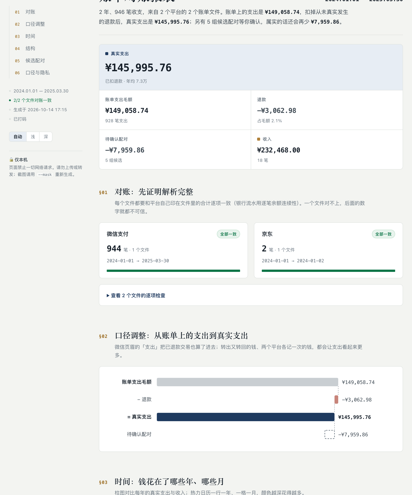

# Skills · Agent 技能合集

**Agent skills forged from real failures.** Each one starts from a specific way an AI agent went wrong in daily work, and turns the fix into a procedure any agent can follow.

**从真实翻车里提炼的 Agent 技能。** 每个技能都始于 AI Agent 在日常工作中的一次具体失误，再把修正方法沉淀成任何 Agent 都能照做的流程。

One folder, one `SKILL.md` — works in **Claude Code, Codex CLI, Cursor, Gemini CLI and OpenClaw**.
一个文件夹、一份 `SKILL.md`，在 **Claude Code、Codex CLI、Cursor、Gemini CLI、OpenClaw** 中通用。

## Skills · 技能

| Skill | What it does | 功能 | Version |
|---|---|---|---|
| [**adaptive-eta**](skills/adaptive-eta) | Gives your agent a sense of time: an honest ETA before long tasks, updates when it slips, a check-in before running far over — and it learns from past misses. | 让 Agent 有时间感：长任务先报预估，超时如实更新，严重超时先问你，并从历史偏差中自我校准。 | 0.3.0 |
| [**wechat-mp-publishing**](skills/wechat-mp-publishing) | WeChat Official Account pipeline — review stats, render images, create drafts in bulk, plus a cadence gate that stops you over-posting. Never presses Publish. | 公众号内容流水线：复盘数据、渲染配图、批量建草稿，外加一道拦住过度发文的节奏闸门。绝不替你点发表。 | 0.1.0 |
| [**cn-bill-parser**](skills/cn-bill-parser) | Parses WeChat Pay, Alipay, JD and China Merchants Bank exports, proves each file against the platform's own totals, flags refunds, round trips and cross-platform duplicates, and renders a private local HTML report. | 解析微信、支付宝、京东、招行账单，先用平台自带合计逐文件对账，找出退款、原路返回与跨平台重复，并生成只在本机打开的 HTML 报表。 | 0.1.0 |

## See it work · 效果演示

### cn-bill-parser — the report it renders · 生成的报表



*Rendered from the synthetic bills in the test suite, not real data. Run it yourself: `python3 skills/cn-bill-parser/scripts/report.py <bills-folder> -o report.html`.*
*由测试用的合成账单生成，不是真实数据。自己跑一遍：上面那条命令。*

> **You:** Here are my WeChat, Alipay and JD bills for last year. How much did I actually spend?
>
> **AI:** All 3 files reconcile with their own totals ✓. Before the number: WeChat's printed expense includes refunded transactions, and I found 4 candidate pairs — 1 JD order also paid through WeChat, 2 transfers to the same person returned within 30 days, 1 same-day offset. Want to go through them one by one?

> **你：** 这是我去年的微信、支付宝、京东账单，我实际花了多少？
>
> **AI：** 3 个文件都和自带合计对上了 ✓。给数字之前先说明：微信页眉的支出里有已退款交易；另外找到 4 组候选配对——1 笔京东订单在微信里也记了一次，2 笔转给同一个人的钱 30 天内原额转回，1 组同日一收一支。要逐组过一遍吗？

### adaptive-eta — an honest clock · 诚实的时间感

> **You:** Refactor the auth module and update the tests.
>
> **AI:** About 6 minutes: read 9 files (~1 min), refactor (~3 min), fix and run tests (~2 min).
>
> **AI:** Slower than planned — two tests depend on the old token format. About 4 more minutes.
>
> **AI:** Done. … *Estimated 6m · actual 9m40s · 1 revision*

> **你：** 重构认证模块，顺便把测试更新了。
>
> **AI：** 预计 6 分钟：读 9 个文件（约 1 分钟）、重构（约 3 分钟）、修测试并运行（约 2 分钟）。
>
> **AI：** 比预期慢——有两个测试依赖旧的 token 格式，还需要约 4 分钟。
>
> **AI：** 完成。…… *预估 6 分钟 · 实际 9 分 40 秒 · 修正 1 次*

### wechat-mp-publishing — a gate that says no · 会说「不」的闸门

> **You:** Turn these three articles into drafts and get them ready to publish.
>
> **AI:** Drafts are done — 3 created, covers, original declaration and creation source all set. But the cadence gate blocks publishing: you've posted 2 times in the last 7 days (limit 2). Earliest safe date is Tuesday. Want me to hold them until then?

> **你：** 把这三篇做成草稿，准备发布。
>
> **AI：** 草稿建好了——3 篇，封面、原创声明、创作来源都已配好。但节奏闸门拦下了发布：最近 7 天已发 2 篇（上限 2 篇），最早可以周二发。要不要先放着，到时候再发？

*The chat transcripts are illustrative of the behavior each skill defines; exact wording varies by agent.*
*对话为示意，展示各技能定义的行为，具体措辞因 Agent 而异。*

## Quick start · 快速开始

Install a single skill — no clone needed — via [`npx skills`](https://github.com/vercel-labs/skills):
单独安装某个技能，无需克隆：

```bash
npx skills add Yanghe1941/skills --list                          # list skills / 查看全部技能
npx skills add Yanghe1941/skills --skill adaptive-eta            # install one / 安装一个
npx skills add Yanghe1941/skills --skill adaptive-eta -g         # user-wide / 装到全局
npx skills add Yanghe1941/skills --skill adaptive-eta -a codex   # pick the agent / 指定工具
```

`-a` accepts `claude-code`, `codex`, `cursor`, `gemini-cli` and more; `-y` skips prompts.
`-a` 可选 `claude-code`、`codex`、`cursor`、`gemini-cli` 等；`-y` 跳过确认。

**OpenClaw**, via [ClawHub](https://clawhub.ai/yanghe1941/skills/adaptive-eta):

```bash
openclaw skills install @yanghe1941/adaptive-eta
```

## Install from a clone · 克隆后安装

Use this if you want to hack on a skill — `--link` symlinks it, so edits take effect immediately.
想改技能时用这种方式——`--link` 以软链接安装，改完即时生效。

```bash
git clone https://github.com/Yanghe1941/skills.git && cd skills
./scripts/install.sh adaptive-eta                    # Claude Code (default / 默认)
./scripts/install.sh adaptive-eta --tool codex       # codex / cursor / gemini / agents
./scripts/install.sh --all --tool cursor --project   # every skill, into this project / 全部装到当前项目
./scripts/install.sh adaptive-eta --link             # symlink for development / 开发用软链接
```

Where each tool looks for skills: [docs/compatibility.md](docs/compatibility.md)
各工具读取技能的目录：[docs/compatibility.md](docs/compatibility.md)

## How these skills are made · 这些技能的标准

| | EN | 中文 |
|---|---|---|
| **Born from a failure** | Every skill starts from a concrete mistake an agent actually made — not from a wishlist. | 每个技能都从一次真实发生的失误出发，而不是凭空设想。 |
| **Humans keep the irreversible** | Publishing, deleting, overwriting: the skill prepares, a person decides. | 发布、删除、覆盖这类不可逆操作，技能只做准备，决定权留给人。 |
| **Honest about limits** | Anything not yet verified is marked as unverified. | 没验证过的就明确标出来。 |
| **Portable** | Standard-library scripts, paths relative to the skill folder, nothing tied to one machine. | 脚本只用标准库，路径相对技能目录，不绑定任何一台机器。 |
| **Private by default** | Generalized from a private setup and privacy-checked before every publish. | 从私人环境提炼，每次发布前都过隐私检查。 |

## Repository layout · 目录结构

```
skills/<name>/        one folder per skill: SKILL.md + README.md (+ scripts/, references/)
                      每个技能一个文件夹
templates/skill/      starting point for a new skill / 新技能模板
scripts/install.sh    install into any supported tool / 多端安装脚本
scripts/validate.py   format, YAML and privacy checks — also runs in CI / 格式、YAML 与隐私校验，CI 同步运行
docs/                 compatibility notes / 兼容性说明
```

## Adding a skill · 新增技能

1. `cp -R templates/skill skills/<name>`, then edit `SKILL.md` and `README.md`.
   复制模板，修改 `SKILL.md` 和 `README.md`。
2. `python3 scripts/validate.py` must pass.
   校验必须通过。
3. Add a row to the table above.
   在上方表格加一行。

`validate.py` checks that `name` matches the folder, the description fits in 1024 characters, every skill has a README, and the frontmatter is valid YAML — an unquoted `: ` inside a value silently breaks installers like `npx skills`.
`validate.py` 会检查：`name` 与文件夹同名、description 不超过 1024 字符、每个技能都有 README、frontmatter 是合法 YAML——值里未加引号的 `: ` 会让 `npx skills` 这类安装器静默跳过该技能。

## Privacy · 隐私

These skills are generalized from a private setup. Keep a local `.privacy-denylist` (git-ignored, one term per line) and `validate.py` will fail if any skill contains one of those terms.
这些技能从私人环境中提炼而来。在本地放一份 `.privacy-denylist`（已被 git 忽略，每行一个词），只要任何技能里出现其中的词，`validate.py` 就会报错。

## License · 许可证

[MIT-0](LICENSE) — use, modify and redistribute freely; no attribution required.
[MIT-0](LICENSE) —— 可自由使用、修改和再分发，无需署名。

© 2026 RJ YOUNG · [@Yanghe1941](https://github.com/Yanghe1941)
